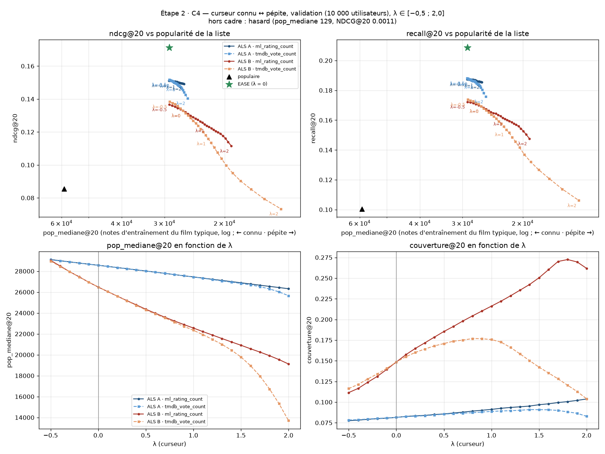

# Étape 2 — Modèle ALS et évaluation hors ligne

> Version 0.1 (6 novembre 2026). Spécification de l'étape 2 de l'ordre de construction (`stack-technique.md` §8).
> Complète `stack-technique.md` et `CLAUDE.md`. Décisions validées le 6 novembre 2026.

---

## 0. Mode d'emploi (pour Claude Code)

- **Relis ce document au début de chaque sous-étape.** Les décisions de la section 3 ne se changent pas sans accord : si l'une pose problème, arrête-toi et explique pourquoi.
- Une sous-étape à la fois (C1 → C6), en suivant la section « Quand s'arrêter » de `CLAUDE.md` : si tous les critères sont atteints et qu'il n'y a rien à trancher, résultats en section 5, commit, push, et sous-étape suivante sans attendre. **Arrêts obligatoires** (mise à jour du 7 novembre 2026) : fin de C3 si ALS est plus de 20 % en dessous d'EASE ; fin du balayage de C4 (choix par Thibault) ; fin de C5 (relecture avant export). Dans chaque compte rendu : ce qui a été fait, critères atteints ou non, choix faits sans demander.
- Après chaque sous-étape, **ajoute les résultats dans la section 5** de ce document (tableaux, chiffres, chemins des figures). C'est la trace qui servira au rapport : chiffres exacts, pas d'arrondis flatteurs.
- **Règle d'or : le jeu de test ne sert pas à régler quoi que ce soit.** Tous les réglages (hyperparamètres, λ, choix de la popularité) se font sur les utilisateurs de validation. Le test est évalué une fois par modèle retenu, et on note le résultat même s'il déçoit.
- Graines aléatoires fixées partout (`SEED = 42` dans `config.py`). Avant l'entraînement : `OPENBLAS_NUM_THREADS=1` et `MKL_NUM_THREADS=1` (recommandation de la librairie `implicit`).

---

## 1. Objectifs

1. Entraîner un modèle **ALS** (librairie `implicit` 0.7.x) et vérifier qu'il recommande bien des films à des utilisateurs **qu'il n'a jamais vus**, exactement comme le fera le site (fold-in).
2. Le comparer à des références simples (populaire, hasard) et à **EASE** (référence de précision, jamais embarqué).
3. Montrer que le **curseur connu ↔ pépite** fonctionne : courbe précision ↔ popularité quand λ varie. Choisir la source de popularité (`ml_rating_count` ou `tmdb_vote_count`).
4. Exporter les vecteurs pour le navigateur (`embeddings.bin` en int8) sans perte de qualité, avec des cas de test qui permettront de vérifier le fold-in TypeScript à l'étape 4.

---

## 2. Données d'entrée

| Fichier | Contenu |
|---|---|
| `pipeline/data/processed/catalog.parquet` | 23 019 films, `item_idx` 0..n-1, colonne `recommendable` (51 à `false`) |
| `pipeline/data/processed/ratings_filtered.parquet` | 31 662 542 notes, uniquement sur les films du catalogue, doublons fusionnés |

- Les films `recommendable = false` **restent dans l'entraînement et le fold-in** (ils aident à comprendre le goût), mais ne sont **jamais proposés** : ils sont retirés des candidats et des films à retrouver (held-out).
- `item_idx` est l'ordre des lignes de la matrice des vecteurs. Il est figé par l'entraînement final (C5), et sauvegardé avec les vecteurs.

---

## 3. Décisions

### D1. Découpage des données

- **Utilisateurs éligibles** à la validation et au test : au moins **10 notes** dans le catalogue.
- Tirage aléatoire (`SEED`) de **10 000 utilisateurs de validation** et **10 000 utilisateurs de test** parmi les éligibles. Tous les autres utilisateurs servent à l'entraînement, avec toutes leurs notes.
- Les utilisateurs de validation et de test **ne sont jamais dans la matrice d'entraînement.** Leur vecteur est calculé par fold-in, comme sur le site.
- Pour chaque utilisateur de validation/test : notes triées par `timestamp` (puis `movie_id` en cas d'égalité). Les **80 % les plus anciennes** (arrondi inférieur) forment le **fold-in** ; les **20 % les plus récentes** (au moins 1) forment le **held-out** à retrouver.
- Limite assumée : des utilisateurs d'entraînement peuvent avoir noté après la période held-out d'un utilisateur de test. C'est le protocole standard « utilisateurs nouveaux » ; on le note dans le rapport.

### D2. Signal et confiance

ALS implicite apprend « a vu / n'a pas vu », pondéré par une confiance.

- **Tout film vu est un positif**, même mal noté.
- `p_ui` = percentile de la note dans l'historique de l'utilisateur, entre 0 et 1 (rang moyen en cas d'égalité : `p = (rang_moyen − 1) / (n − 1)`, et `p = 0,5` si l'utilisateur n'a qu'une note).
- Valeur stockée dans la matrice : `r_ui = 1 + β × p_ui` (donc toujours ≥ 1 : jamais de zéro, qui ferait disparaître le film d'une matrice creuse). `β = 0` équivaut à un signal binaire.
- **Film vu sans note** (cas fréquent dans `watched.csv` de Letterboxd) : `p = 0,5`.
- La confiance finale vient de `r_ui` et du paramètre `alpha` d'`implicit`. **À vérifier dans le code d'`implicit` 0.7.x** : la formule exacte qui transforme les valeurs de la matrice et `alpha` en confiance, et la documenter ici. Le fold-in maison (D4) doit utiliser exactement la même.
- Pour le fold-in d'un utilisateur de validation/test, les percentiles sont calculés **sur son fold-in uniquement** (pas de fuite du held-out).

**Pertinence pour l'évaluation** : un film held-out est **pertinent** si sa note est **≥ la médiane des notes du fold-in** de cet utilisateur. On rapporte aussi une variante secondaire « tout film held-out compte » (`recall_all`).

### D3. Métriques et références

Candidats pour un utilisateur : films `recommendable = true` qui ne sont pas dans son fold-in. Le held-out est restreint aux films recommandables.

| Métrique | Définition |
|---|---|
| `Recall@20` | films pertinents trouvés dans le top 20 / min(20, nombre de pertinents) |
| `NDCG@20` | gain binaire (pertinent = 1), normalisé par le NDCG idéal |
| `recall_all@20` | comme Recall@20, avec tout le held-out comme pertinent |
| `pop_moyenne@20` | moyenne de `log(1 + ml_rating_count)` des films recommandés (plus bas = plus pépite) |
| `pop_mediane@20` | médiane du nombre de notes des films recommandés (lisible : « un film typique de la liste a N notes ») |
| `couverture@20` | films distincts recommandés à au moins un utilisateur / films recommandables |
| `longue_traine@20` | part des recos hors des 20 % de films les plus populaires |

- Chaque métrique est donnée en **moyenne ± intervalle de confiance à 95 %** (erreur standard × 1,96 sur les utilisateurs).
- Utilisateurs sans aucun film pertinent dans leur held-out : exclus de Recall/NDCG (comptés et signalés), inclus dans les métriques de popularité et de couverture.
- **Références** à rapporter systématiquement : `populaire` (films les plus notés par les utilisateurs d'entraînement) et `hasard` (`SEED`).
- Pour l'évaluation, `ml_rating_count` est **recalculé sur les seuls utilisateurs d'entraînement** (pas de fuite). En production, on utilisera les comptes complets.

### D4. Fold-in (calcul du vecteur d'un nouvel utilisateur)

- Formule ALS implicite : `x_u = (YᵀY + Yᵀ(C_u − I)Y + λ_reg·I)⁻¹ · Yᵀ C_u p_u`, avec `Y` les vecteurs des films, `C_u` les confiances de l'utilisateur, `p_u` = 1 sur ses films vus. À aligner exactement sur ce que fait `implicit` (régularisation, éventuelle mise à l'échelle).
- Implémentation **maison en NumPy** (`pipeline/models/als.py`), qui servira de référence pour la version TypeScript. Elle doit donner le même résultat que le recalcul d'utilisateur fourni par `implicit` (critère en C2).
- `YᵀY` (64 × 64) est précalculé et exporté (C5) : le navigateur n'a qu'un petit système 64 × 64 à résoudre.

### D5. Curseur connu ↔ pépite

Les scores ALS n'ont pas la même échelle d'un utilisateur à l'autre. Pour qu'un même λ ait le même effet pour tous :

- `s_ui` = score ALS **centré-réduit sur les candidats de l'utilisateur** (moyenne 0, écart-type 1).
- `z_i` = `log(1 + popularité_i)` **centré-réduit sur l'ensemble des films recommandables** (calculé une fois).
- **Score final : `score_ui = s_ui − λ × z_i`.**
- Balayage de λ de **−0,5 à 2,0 par pas de 0,1** (les valeurs négatives favorisent les classiques : à voir si l'extrémité gauche du curseur doit aller jusque-là).
- Deux sources de popularité testées : `ml_rating_count` (comptes d'entraînement) et `tmdb_vote_count` (manquant → plus petite valeur observée).
- **Livrable clé** : la courbe `NDCG@20` (ou `Recall@20`) en fonction de `pop_mediane@20` quand λ varie, une courbe par source de popularité, avec les références `populaire` et `hasard` en points.
- Le choix de la source et de la plage de λ se fait sur la validation, **par Thibault**, au vu des courbes (C4). Le choix de la configuration ALS finale aussi (deux candidates, voir C4).

### D6. Hyperparamètres d'ALS

| Paramètre | Valeurs testées |
|---|---|
| `factors` | 32, **64** (défaut), 128 — 128 seulement si gain ≥ 3 % relatif de NDCG@20, car il double la taille |
| `regularization` | 0,01 ; 0,05 ; 0,1 ; 0,5 |
| `alpha` | 1 ; 5 ; 10 ; 20 ; 40 |
| `β` (D2) | 0 ; 1 ; 3 |
| `iterations` | 15 (vérifier la convergence sur la meilleure config : 15 vs 30) |

- Recherche limitée (~30 configurations, tirées au hasard dans la grille, `SEED`), évaluée sur la **validation** à λ = 0. Critère de choix : `NDCG@20`.
- Rapporter les 5 meilleures configurations et le temps d'entraînement.
- Le modèle final pour l'export (C5) est **réentraîné sur tous les utilisateurs** (entraînement + validation + test) avec la configuration retenue.

### D7. EASE (comparaison uniquement)

- Matrice `X` utilisateurs d'entraînement × films, mêmes valeurs que D2 avec le `β` retenu (et variante binaire).
- `G = XᵀX + λ_ease·I`, `P = G⁻¹`, `B = I − P · diag(1 / diag(P))` (diagonale de `B` à 0). Score d'un utilisateur : `x_u · B` avec son fold-in, sans entraînement supplémentaire.
- `λ_ease` testé : 100 ; 300 ; 1 000 ; 3 000 ; 10 000 (validation).
- **Mémoire** : `G` fait 23 019² × 4 octets ≈ 2,1 Go en float32 ; l'inversion en demande 3 à 4 fois plus. **Vérifier la RAM disponible avant de lancer.** Si elle ne suffit pas, préparer un notebook Google Colab à la place.
- EASE n'est **jamais exporté** vers le site.

### D8. Quantification et export

- Vecteurs des films en **int8**, échelle symétrique par film : `scale_i = max|y_i| / 127`, une échelle float32 par film.
- **`YᵀY` est calculé à partir des vecteurs déquantifiés**, pour que le navigateur fasse exactement le même calcul que le test.
- Critère : perte **< 1 % relative** sur `NDCG@20` et `Recall@20` (test, à λ = 0 et à une valeur de λ intermédiaire) entre float32 et int8.
- Fichiers produits dans `web/public/data/` (non versionnés) :
  - `embeddings.bin` : en-tête (magie `PEPE`, version, `n_items`, `dims`, little-endian), puis vecteurs int8 `n_items × dims`, puis échelles float32 `n_items` ;
  - `yty.bin` : float32 `dims × dims` ;
  - `model-meta.json` : version, date, `dims`, `regularization`, `alpha`, `β`, formule de confiance, source de popularité choisie, liste des `movie_id` dans l'ordre de `item_idx`, version des données (hash du manifeste) ;
  - `popularity.bin` : comptes de la source choisie (uint32), dans l'ordre de `item_idx`.
- **Cas de test du fold-in** : `pipeline/tests/fixtures/foldin_cases.json` (versionné) : 20 historiques de test (films, percentiles), vecteur attendu et top 10 attendu à λ = 0 et à λ intermédiaire. Calculés avec les vecteurs **déquantifiés**. Ils serviront à tester le code TypeScript à l'étape 4.
- `catalog.json` et `title-index.json` ne sont **pas** produits ici (étapes 3-4).

### D9. Seuil ≥ 10 (optionnel)

- Seulement si ALS ≥ 20 donne des résultats satisfaisants (C2-C4 validés).
- Construire un catalogue ≥ 10 dans un **dossier séparé** (ne pas écraser le catalogue ≥ 20), mêmes utilisateurs de validation/test, même protocole.
- EASE ≥ 10 : ~4,2 Go par matrice → Colab.
- Comparer : NDCG/Recall sur le held-out complet, `longue_traine@20`, `couverture@20`, taille de l'export. La décision revient à Thibault.

---

## 4. Sous-étapes

### C1 — Découpage, métriques, références

**Objectif** : le protocole d'évaluation complet, testé, avant tout modèle.

**Fichiers** : `pipeline/split.py`, `pipeline/metrics.py`, `pipeline/baselines.py`, `pipeline/evaluate.py` (lance un modèle sur la validation ou le test, écrit les résultats en JSON dans `pipeline/data/processed/results/`), tests associés. Constantes (`SEED`, tailles, seuil d'éligibilité) dans `config.py`.

**Sorties** : `pipeline/data/processed/split/` : `train.parquet`, `val_foldin.parquet`, `val_heldout.parquet`, `test_foldin.parquet`, `test_heldout.parquet`, `users.parquet` (userId → rôle).

**Critères** :
- 10 000 utilisateurs de validation, 10 000 de test, aucun utilisateur dans deux rôles ; nombre d'utilisateurs d'entraînement et d'éligibles rapportés.
- Chaque utilisateur de validation/test a ≥ 8 films en fold-in et ≥ 2 en held-out ; aucun film held-out n'a un timestamp antérieur au dernier film de son fold-in.
- Relancer `split.py` produit exactement les mêmes fichiers (hash identique).
- Métriques testées sur des exemples calculés à la main (Recall, NDCG, cas sans pertinent, cas avec moins de 20 pertinents).
- Résultats des références `populaire` et `hasard` sur la validation, avec intervalles de confiance. Attendu : `populaire` très au-dessus de `hasard`.
- Nombre d'utilisateurs de validation sans film pertinent rapporté.

### C2 — ALS

**Objectif** : entraîner ALS, évaluer par fold-in, régler les hyperparamètres.

**Fichiers** : ajouter `implicit` aux dépendances ; `pipeline/models/als.py` (entraînement, fold-in NumPy, scores), `pipeline/train.py`, tests.

**Critères** :
- Formule de confiance d'`implicit` documentée dans D2 (section 5).
- Fold-in maison vs recalcul d'`implicit` sur 200 utilisateurs de validation : similarité cosinus des vecteurs > 0,999 et top 20 identique pour ≥ 95 % d'entre eux.
- Tableau des ~30 configurations (validation, λ = 0), 5 meilleures mises en avant, temps d'entraînement.
- Vérification de convergence (15 vs 30 itérations) sur la meilleure configuration.
- La meilleure configuration bat `populaire` sur `NDCG@20` en validation, intervalles de confiance non chevauchants.
- Une seule évaluation sur le **test** avec la configuration retenue.
- Pas d'arrêt obligatoire : si les critères sont atteints, enchaîner sur C3.

### C3 — EASE

**Objectif** : la référence de précision.

**Fichiers** : `pipeline/models/ease.py`, tests (petit exemple calculable à la main). Notebook Colab si la RAM manque (`pipeline/train_ease.py`, `pipeline/colab_bundle.py`, `pipeline/notebooks/ease_colab.ipynb`).

**Critères** :
- RAM disponible vérifiée et rapportée avant le calcul.
- `λ_ease` choisi sur la validation ; résultats test EASE vs ALS vs références.
- Écart relatif ALS / EASE sur `NDCG@20` rapporté. Si ALS est plus de 20 % en dessous d'EASE : le signaler et proposer des pistes (plus de facteurs, autre `alpha`/`β`), sans les lancer.
- **Le seuil des 20 % s'applique au modèle retenu en C2 (A).** La candidate B (C4) n'a pas à le passer : son écart est rapporté pour information, et elle est jugée sur les courbes du curseur (précision ↔ popularité). Pas de piste d'amélioration lancée pour B (décision du 7 novembre 2026).
- **Arrêt obligatoire seulement si ALS est plus de 20 % en dessous d'EASE.** Sinon, enchaîner sur C4. Si la RAM ne suffit pas pour EASE : préparer le notebook Colab et s'arrêter pour que Thibault le lance.

### C4 — Curseur

**Objectif** : montrer que le curseur fonctionne, choisir la source de popularité **et le modèle ALS final**.

**Fichiers** : `pipeline/slider.py` (re-classement D5), script de balayage, figures dans `docs/figures/` (PNG versionnés).

**Deux configurations ALS candidates** (ajout du 7 novembre 2026, voir section 5 « C2 — complément ») :
- **A — précision à λ = 0** : la configuration retenue en C2 (`factors 64, reg 0,05, alpha 1, β 1, 30 it.`).
- **B — alpha élevé** : la meilleure en `NDCG@20` parmi `alpha ≥ 10` de la recherche, à 64 facteurs (`factors 64, reg 0,1, alpha 10, β 1, 30 it.`) : listes plus variées, potentiellement meilleure une fois le curseur appliqué.
- Le balayage du curseur se fait **pour A et pour B** (× 2 sources de popularité). **Le choix final du modèle se fait au vu des courbes précision ↔ popularité, pas à λ = 0.**

**Critères** :
- Balayage λ ∈ [−0,5 ; 2,0] pas 0,1, sur la validation, pour les deux configurations ALS et les deux sources de popularité : tableau complet + figure `etape2-curseur-validation.png` (précision vs `pop_mediane@20`, une courbe par configuration × source, références en points).
- Pour 3 utilisateurs de test au profil différent : les 10 titres recommandés à λ = 0, λ intermédiaire et λ max (`tmdb_title`, année, nombre de notes). Contrôle qualitatif : les pépites ont-elles l'air cohérentes ?
- **Arrêt obligatoire à la fin du balayage** : Thibault choisit la configuration ALS (A ou B), la source de popularité et la plage de λ. Ensuite seulement, évaluation sur le test pour la configuration choisie + figure `etape2-curseur-test.png`. Ce choix fixe le modèle réentraîné et exporté en C5.

### C5 — Modèle final, quantification, export

**Objectif** : les fichiers que le navigateur chargera.

**Fichiers** : `pipeline/export.py`, `pipeline/tests/fixtures/foldin_cases.json`, tests.

**Critères** :
- Modèle final réentraîné sur tous les utilisateurs avec la configuration retenue.
- Perte int8 vs float32 < 1 % relative (protocole D8, mesuré avec le modèle de C2 sur le test).
- `embeddings.bin` ≈ 23 019 × 64 + 23 019 × 4 octets ≈ 1,6 Mo ; tailles réelles de tous les fichiers rapportées (brutes et gzip).
- Relecture de `embeddings.bin` en Python → vecteurs identiques aux vecteurs déquantifiés.
- Les cas de test du fold-in se rejouent à l'identique depuis les fichiers exportés.
- Aucune colonne `imdbds_` dans ce qui est écrit dans `web/public/data/` (garde-fou `FORBIDDEN_WEB_PREFIXES`).
- **Arrêt obligatoire à la fin de C5** : relecture par Thibault avant de considérer l'export comme terminé.

### C6 — Seuil ≥ 10 (optionnel)

Voir D9. Uniquement sur demande de Thibault.

### Fin de l'étape 2

Mettre à jour `docs/stack-technique.md` (§3, §4, §8, §9) et `CLAUDE.md` (étape 2 ✅, chiffres clés, commandes) avec les choix réels. Montrer le diff avant de committer.

---

## 5. Résultats

*À remplir par Claude Code à la fin de chaque sous-étape.*

### C1

*6 novembre 2026.* Code : `pipeline/split.py`, `metrics.py`, `baselines.py`, `evaluate.py` ; tests `tests/test_split.py`, `test_metrics.py`, `test_evaluate.py` (105 tests au total, tous verts). Constantes dans `config.py` (`SEED`, `MIN_EVAL_USER_RATINGS`, `N_VAL_USERS`, `N_TEST_USERS`, `FOLDIN_NUM/DEN`, `TOP_K`, `LONG_TAIL_HEAD_SHARE`, `SPLIT_DIR`, `RESULTS_DIR`).

**Découpage** (`data/processed/split/`, empreintes dans `manifest.json`)

| | Utilisateurs | Notes |
|---|---|---|
| Tous | 200 948 | 31 662 542 |
| Éligibles (≥ 10 notes) | 200 945 | |
| Entraînement | 180 948 (dont les 3 non éligibles) | 28 507 516 |
| Validation | 10 000 | fold-in 1 253 287 · held-out 318 303 |
| Test | 10 000 | fold-in 1 262 799 · held-out 320 637 |

- Aucun utilisateur dans deux rôles ; aucun utilisateur de validation/test dans `train.parquet` (vérifié par `check_split`, qui fait échouer le script sinon).
- Fold-in : minimum 12 (validation) et 11 (test) films, médiane 58 ; held-out : minimum 4 (validation) et 3 (test). Critères ≥ 8 et ≥ 2 respectés largement (MovieLens ne garde que des utilisateurs avec ≥ 20 notes).
- Aucun film held-out n'a un timestamp antérieur au dernier film du fold-in (vérifié).
- Deux exécutions de `split.py` → les 6 fichiers ont des sha256 identiques.

**Références sur la validation** (10 000 utilisateurs, k = 20, moyenne ± IC 95 %)

| Métrique | `populaire` | `hasard` |
|---|---|---|
| `Recall@20` | 0,10052 ± 0,00314 | 0,00127 ± 0,00025 |
| `NDCG@20` | 0,08544 ± 0,00263 | 0,00107 ± 0,00021 |
| `recall_all@20` | 0,10204 ± 0,00282 | 0,00164 ± 0,00021 |
| `pop_moyenne@20` (log(1 + n)) | 11,0202 ± 0,0026 | 5,0930 ± 0,0078 |
| `pop_mediane@20` (notes) | 59 050 ± 130 | 128,6 ± 1,7 |
| `longue_traine@20` | 0,000 ± 0,000 | 0,8031 ± 0,0017 |
| `couverture@20` | 0,01075 (247 films) | 0,99983 |

- `populaire` est ~80 fois au-dessus de `hasard` sur `NDCG@20` ; intervalles très loin de se chevaucher.
- Contrôle : le `Recall@20` attendu analytiquement pour `hasard` (20·R / n_candidats / min(20, R), moyenné) vaut 0,00125, mesuré 0,00127.
- **93 utilisateurs de validation (0,93 %) n'ont aucun film pertinent** dans leur held-out : exclus de Recall/NDCG (n = 9 907), inclus ailleurs. Aucun n'a un held-out vide après restriction aux recommandables (60 notes held-out portaient sur des films non recommandables et ont été retirées).
- Held-out recommandable : médiane 15 films, dont 9 pertinents (64 % des films held-out en moyenne sont pertinents).
- Résultats : `data/processed/results/popular_val.json`, `random_val.json`. Le test n'a pas été évalué.

**Choix faits sans demander (C1)**
- Le held-out est stocké complet dans `split/` ; la restriction aux films recommandables se fait dans `evaluate.py` (le découpage ne dépend pas des drapeaux du catalogue).
- Taille du fold-in : `min(⌊4n/5⌋, n − 1)` en arithmétique entière (pas de flottant).
- Tirage : `np.random.default_rng(SEED).permutation` des `userId` éligibles triés ; les 10 000 premiers → validation, les 10 000 suivants → test.
- Médiane du fold-in : médiane classique (moyenne des deux valeurs centrales si nombre pair).
- `pop_mediane@20` : médiane par utilisateur, puis moyenne ± IC sur les utilisateurs (comme toutes les métriques par utilisateur). `couverture@20` est une valeur globale, sans IC.
- `longue_traine@20` : « tête » = les `round(0,2 × 22 968)` = 4 594 films recommandables les plus notés par les utilisateurs d'entraînement (égalités départagées par `item_idx`).
- `hasard` : scores uniformes tirés d'un seul générateur (`SEED`), utilisateurs dans l'ordre des `userId`, par lots de 1 000 (résultat reproductible tant que la taille de lot ne change pas).
- Interface commune des modèles : `scores(foldin_csr) → matrice (utilisateurs × films)` ; le masquage (fold-in, non recommandables) est fait par `evaluate.py`, pas par les modèles.

### C2

*6 novembre 2026.* Code : `pipeline/models/als.py` (signal D2, entraînement, fold-in NumPy, adaptateur pour `evaluate.py`), `pipeline/train.py` (`check-foldin`, `time`, `search`, `run`), `tests/test_als.py`. Dépendance ajoutée : `implicit==0.7.3`.

**Formule de confiance d'`implicit` 0.7.3** (lue dans `pipeline/.venv/Lib/site-packages/implicit/cpu/als.py`)

- `fit` (l. 132-134) et `recalculate_user` (l. 227-228) : `if self.alpha != 1.0: Cui = self.alpha * Cui`. La matrice passée est donc multipliée par `alpha` : **`C_ui = alpha × r_ui = alpha × (1 + β·p_ui)`**, `P_ui = 1` sur les cases stockées ; les cases absentes valent `C = 1`, `P = 0`.
- Système résolu pour chaque utilisateur (référence Python `user_linear_equation`, l. 494-513 ; le solveur compilé `_als._least_squares` utilisé par `recalculate_user` fait le même calcul par Cholesky) :
  `(YᵀY + reg·I + Σ_i (C_ui − 1)·y_i y_iᵀ) · x_u = Σ_i C_ui·y_i`, sommes sur les films de l'utilisateur.
- `YᵀY` = `item_factors.T @ item_factors` sans régularisation (propriété `YtY`, l. 426-430) ; la régularisation **n'est pas** multipliée par le nombre de films de l'utilisateur.
- Conséquence à garder en tête : avec `alpha = 1` et `β = 0`, `C = 1` partout, les films vus n'ont pas plus de poids que les non-vus (seule la cible `P` les distingue).
- L'entraînement utilise le gradient conjugué (`use_cg=True` par défaut, 3 pas) ; le fold-in (le nôtre comme `recalculate_user`) est une résolution exacte.

**Fold-in NumPy vs `recalculate_user`** (`train.py check-foldin`, config `factors 64, reg 0.05, alpha 10, β 1, 15 it.`, 200 utilisateurs de validation tirés avec `SEED`) — ✅

| Mesure | Valeur | Critère |
|---|---|---|
| Cosinus minimum | 0,99999999998 | > 0,999 |
| Erreur L2 relative maximum | 7,0 × 10⁻⁶ | |
| Top 20 identique (même ordre) | 100 % | ≥ 95 % |

Résultat : `data/processed/results/als_foldin_check.json`. Tests unitaires : le fold-in égale la référence Python d'`implicit` à 10⁻⁹ près, et un cas à un film calculé à la main.

**Durée** : factors 64, 15 itérations, 8 cœurs : 114,5 s d'entraînement + 9,5 s d'évaluation (10 000 utilisateurs). NDCG@20 de cette config en validation : 0,13273 ± 0,00312.

**Recherche d'hyperparamètres** (`train.py search`) : 30 configurations tirées sans remise dans la grille D6 complète (180 combinaisons, `SEED`) : 14 à 64 facteurs, 11 à 128, 5 à 32. 15 itérations, validation, λ = 0. Un JSON par configuration dans `data/processed/results/als_search/` (reprise possible : les configurations déjà faites sont sautées). Durée réelle : 4 262 s d'entraînement cumulé (71 min), ~75 min au total ; les configs à 128 facteurs ont pris 145-211 s, à peine plus qu'à 64.

Tableau complet, trié par `NDCG@20` (validation, moyenne ± IC 95 % ; `pop_mediane` en nombre de notes d'entraînement) :

| # | factors | reg | alpha | β | NDCG@20 | Recall@20 | recall_all@20 | pop_mediane@20 | longue_traine@20 | couverture@20 | entraînement (s) |
|---|---|---|---|---|---|---|---|---|---|---|---|
| 1 | 64 | 0.05 | 1 | 1 | 0,15039 ± 0,00337 | 0,18654 ± 0,00428 | 0,18834 | 28533 | 0,0000 | 0,0812 | 158 |
| 2 | 32 | 0.1 | 1 | 3 | 0,14948 ± 0,00344 | 0,18237 ± 0,00424 | 0,18139 | 33195 | 0,0000 | 0,0740 | 107 |
| 3 | 32 | 0.1 | 1 | 1 | 0,14789 ± 0,00345 | 0,17973 ± 0,00422 | 0,18126 | 33532 | 0,0000 | 0,0673 | 86 |
| 4 | 128 | 0.05 | 1 | 1 | 0,14476 ± 0,00322 | 0,17769 ± 0,00404 | 0,18242 | 22866 | 0,0000 | 0,0950 | 183 |
| 5 | 32 | 0.05 | 1 | 0 | 0,14244 ± 0,00338 | 0,17437 ± 0,00420 | 0,17859 | 33374 | 0,0000 | 0,0630 | 62 |
| 6 | 128 | 0.1 | 5 | 1 | 0,14209 ± 0,00319 | 0,18072 ± 0,00422 | 0,18203 | 23755 | 0,0006 | 0,1381 | 149 |
| 7 | 64 | 0.05 | 5 | 1 | 0,14196 ± 0,00326 | 0,17879 ± 0,00423 | 0,17942 | 27786 | 0,0002 | 0,1199 | 140 |
| 8 | 128 | 0.5 | 5 | 3 | 0,14181 ± 0,00317 | 0,18144 ± 0,00424 | 0,18001 | 24365 | 0,0012 | 0,1549 | 209 |
| 9 | 128 | 0.01 | 5 | 1 | 0,14170 ± 0,00317 | 0,18022 ± 0,00421 | 0,18178 | 23563 | 0,0006 | 0,1378 | 211 |
| 10 | 64 | 0.5 | 5 | 3 | 0,14070 ± 0,00322 | 0,17769 ± 0,00417 | 0,17613 | 27316 | 0,0006 | 0,1379 | 139 |
| 11 | 64 | 0.01 | 5 | 0 | 0,13957 ± 0,00326 | 0,17595 ± 0,00423 | 0,17901 | 27800 | 0,0001 | 0,1092 | 99 |
| 12 | 128 | 0.1 | 10 | 0 | 0,13296 ± 0,00309 | 0,17079 ± 0,00414 | 0,17422 | 23557 | 0,0008 | 0,1493 | 146 |
| 13 | 64 | 0.1 | 10 | 1 | 0,13293 ± 0,00312 | 0,16880 ± 0,00407 | 0,16997 | 26553 | 0,0008 | 0,1472 | 144 |
| 14 | 128 | 0.05 | 10 | 0 | 0,13275 ± 0,00308 | 0,17059 ± 0,00414 | 0,17406 | 23530 | 0,0008 | 0,1493 | 145 |
| 15 | 64 | 0.01 | 10 | 1 | 0,13271 ± 0,00311 | 0,16916 ± 0,00408 | 0,16991 | 26479 | 0,0008 | 0,1466 | 131 |
| 16 | 128 | 0.1 | 10 | 3 | 0,12974 ± 0,00300 | 0,16998 ± 0,00411 | 0,16866 | 23762 | 0,0027 | 0,1831 | 203 |
| 17 | 32 | 0.05 | 10 | 0 | 0,12940 ± 0,00317 | 0,16183 ± 0,00405 | 0,16629 | 29959 | 0,0001 | 0,1103 | 76 |
| 18 | 64 | 0.5 | 10 | 3 | 0,12898 ± 0,00304 | 0,16535 ± 0,00401 | 0,16497 | 25693 | 0,0018 | 0,1693 | 147 |
| 19 | 64 | 0.05 | 20 | 0 | 0,12193 ± 0,00298 | 0,15738 ± 0,00398 | 0,16099 | 25328 | 0,0012 | 0,1625 | 103 |
| 20 | 128 | 0.01 | 20 | 1 | 0,12104 ± 0,00290 | 0,16107 ± 0,00406 | 0,16153 | 23106 | 0,0032 | 0,1934 | 164 |
| 21 | 64 | 0.1 | 20 | 1 | 0,12024 ± 0,00293 | 0,15631 ± 0,00393 | 0,15786 | 24602 | 0,0024 | 0,1806 | 168 |
| 22 | 64 | 0.05 | 20 | 1 | 0,12004 ± 0,00292 | 0,15639 ± 0,00393 | 0,15800 | 24612 | 0,0023 | 0,1803 | 124 |
| 23 | 128 | 0.1 | 20 | 3 | 0,11663 ± 0,00284 | 0,15699 ± 0,00398 | 0,15581 | 22622 | 0,0056 | 0,2178 | 166 |
| 24 | 128 | 0.05 | 20 | 3 | 0,11609 ± 0,00283 | 0,15662 ± 0,00399 | 0,15555 | 22634 | 0,0054 | 0,2168 | 210 |
| 25 | 64 | 0.01 | 20 | 3 | 0,11332 ± 0,00281 | 0,14986 ± 0,00385 | 0,14971 | 23285 | 0,0046 | 0,2055 | 141 |
| 26 | 64 | 0.5 | 40 | 0 | 0,10960 ± 0,00281 | 0,14423 ± 0,00383 | 0,14780 | 23270 | 0,0038 | 0,1996 | 97 |
| 27 | 64 | 0.5 | 40 | 1 | 0,10626 ± 0,00275 | 0,14130 ± 0,00379 | 0,14309 | 22230 | 0,0060 | 0,2201 | 152 |
| 28 | 128 | 0.01 | 40 | 1 | 0,10617 ± 0,00269 | 0,14630 ± 0,00390 | 0,14650 | 21872 | 0,0064 | 0,2256 | 172 |
| 29 | 32 | 0.01 | 40 | 1 | 0,10369 ± 0,00272 | 0,13650 ± 0,00371 | 0,13965 | 24077 | 0,0033 | 0,1931 | 86 |
| 30 | 64 | 0.5 | 40 | 3 | 0,09965 ± 0,00265 | 0,13474 ± 0,00372 | 0,13529 | 20550 | 0,0106 | 0,2464 | 145 |

**5 meilleures** : lignes 1 à 5 ci-dessus. Lecture :
- `alpha` est le paramètre qui compte : NDCG@20 baisse régulièrement de `alpha` 1 (0,142-0,150) à 40 (0,100-0,110). Plus `alpha` est grand, plus les listes sont variées (couverture 0,08 → 0,25) et un peu moins populaires.
- `factors` : la meilleure config à 128 (0,14476) est **en dessous** de la meilleure à 64 (0,15039) → la règle D6 (≥ 3 % de gain) exclut 128. 32 facteurs est dans l'IC de 64 (ligne 2 : 0,14948 ± 0,00344).
- `β` et `reg` : effet faible, dans les IC.
- À λ = 0, **toutes** les configurations recommandent presque uniquement des films de la tête (`longue_traine@20` ≤ 0,011, `pop_mediane@20` 20 000-33 000 notes). Le curseur (C4) aura tout le travail de « pépite » à faire.
- ⚠️ La meilleure valeur, `alpha = 1`, est **au bord de la grille** (valeur la plus basse testée). `alpha < 1` (où les films vus pèsent moins que les non-vus, `C − 1 < 0` pour β = 0) n'a pas été testé.

**Convergence** (meilleure config, validation) :

| Itérations | NDCG@20 | Recall@20 | Entraînement |
|---|---|---|---|
| 15 | 0,15039 ± 0,00337 | 0,18654 ± 0,00428 | 158 s |
| 30 | 0,15106 ± 0,00337 | 0,18749 ± 0,00429 | 241 s |

+0,4 % relatif, très en deçà de l'IC : convergé à 15. **Configuration retenue : factors 64, reg 0,05, alpha 1, β 1, 30 itérations** (30 plutôt que 15 : très légèrement meilleur en validation, ne coûte que du temps d'entraînement hors ligne).

**Comparaison avec `populaire`** (validation) : ALS 0,15106 ± 0,00337 [0,1477 ; 0,1544] vs `populaire` 0,08544 ± 0,00263 [0,0828 ; 0,0881] sur NDCG@20 : +77 % relatif, intervalles non chevauchants ✅.

**Évaluation unique sur le test** (config retenue, 10 000 utilisateurs, 73 sans film pertinent → n = 9 927 pour Recall/NDCG). Les références `populaire` et `hasard` ont aussi été évaluées sur le test (une fois, elles n'ont aucun réglage).

| Métrique | ALS (retenu) | `populaire` | `hasard` |
|---|---|---|---|
| `NDCG@20` | **0,15215 ± 0,00334** | 0,08413 ± 0,00263 | 0,00098 ± 0,00019 |
| `Recall@20` | 0,18946 ± 0,00427 | 0,09913 ± 0,00309 | 0,00110 ± 0,00020 |
| `recall_all@20` | 0,19133 ± 0,00388 | 0,10160 ± 0,00284 | 0,00153 ± 0,00021 |
| `pop_moyenne@20` | 10,2022 ± 0,0075 | 11,0188 ± 0,0026 | 5,0930 ± 0,0078 |
| `pop_mediane@20` | 28 524 ± 205 | 58 983 ± 132 | 128,7 ± 1,8 |
| `longue_traine@20` | 0,0000 | 0,0000 | 0,8031 ± 0,0018 |
| `couverture@20` | 0,0811 (1 863 films) | 0,0104 | 0,9999 |

Test cohérent avec la validation (NDCG 0,15215 vs 0,15106). Fichiers : `results/als_f64_r0.05_a1_b1_i30_test.json`, `popular_test.json`, `random_test.json` ; `train.py run --split test` refuse d'écraser un résultat de test existant.

**Choix faits sans demander (C2)**
- Échantillon de 30 configurations tiré dans la grille **complète** (factors compris), et non 64 seul puis 32/128 ; 15 itérations pour toutes.
- Lors de la recherche, configurations exécutées regroupées par `β` (pour réutiliser la matrice du signal) ; l'ordre ne change aucun résultat (graine fixée par config).
- `random_state = SEED` pour l'initialisation d'`implicit` ; `num_threads` par défaut (8 cœurs) ; solveur par gradient conjugué par défaut pour l'entraînement.
- Top 20 « identique » du contrôle de fold-in : même liste **dans le même ordre** (plus strict que même ensemble ; les deux valent 100 %).
- 30 itérations retenues plutôt que 15 (voir ci-dessus).
- Références `populaire` et `hasard` évaluées sur le test, pour avoir la comparaison complète.

### C2 — complément (7 novembre 2026, validation uniquement)

**1. Contrôle de `longue_traine@20` ≈ 0** (config retenue, validation, 10 000 × 20 = 200 000 recommandations)

Rang de popularité = rang parmi les 22 968 films recommandables selon le nombre de notes d'entraînement (1 = le plus noté). La « tête » = rangs 1 à 4 594, soit les films à **≥ 820 notes** d'entraînement.

| Mesure | Toutes les recos (200 000) | Films distincts (1 871) |
|---|---|---|
| Rang médian | 129 | |
| Rang au 99e centile | 1 312 | 3 097 |
| Rang maximal | 4 606 | 4 606 |
| Nombre minimal de notes | 817 | |

- **Une seule** recommandation sur 200 000 est hors de la tête (rang 4 606, *The Red Shoes*, 1948, 817 notes) : `longue_traine@20` = 1 / 200 000 = 0,000005, affiché 0,00001. La valeur n'est pas un bug : ALS à λ = 0 reste dans les ~4 600 films les plus notés.
- Vérification à la main sur cet utilisateur (`userId` 171795, fold-in de 5 849 films) : sur ses 20 films, 1 a un rang > 4 594 → 1/20 = 0,05 ; la métrique donne 0,05 ✅. Sa liste est elle-même plutôt cinéphile (*Suspiria*, *Le Cuirassé Potemkine*, *La Jetée*, *Le Samouraï*, *Les Nuits de Cabiria*, *Printemps, été, automne, hiver… et printemps*), mais tous ces films ont plus de 1 000 notes.
- Vecteurs de ce modèle sauvegardés pour C4 : `data/processed/models/als_f64_r0.05_a1_b1_i30_item_factors.npy` (non versionné).

**2. Extension de `alpha` sous 1** (`factors 64, reg 0,05, 30 it.`, validation)

Avec `C = alpha × r` et `r = 1 + β·p ∈ [1 ; 1 + β]`, **`alpha < 1` donne une confiance `C < 1` à certains films vus** : tous avec β = 0, et ceux de percentile `p < (1/alpha − 1)/β` avec β = 1 (p < 3 pour alpha = 0,25, donc tous ; p < 1 pour alpha = 0,5, donc tous sauf le mieux noté). Un film vu pèse alors *moins* dans le système qu'un film non vu (`C − 1 < 0`), tout en restant une cible `P = 1`. La matrice reste définie positive (`YᵀY + Σ_vus (C − 1) y yᵀ = Σ_non-vus y yᵀ + Σ_vus C y yᵀ`).

| alpha | β | NDCG@20 | Recall@20 | pop_mediane@20 | couverture@20 | vs retenue |
|---|---|---|---|---|---|---|
| 0,25 | 0 | 0,13147 ± 0,00307 | 0,16095 ± 0,00382 | 27 173 | 0,0548 | −13,0 % |
| 0,25 | 1 | 0,14301 ± 0,00323 | 0,17414 ± 0,00398 | 27 865 | 0,0603 | −5,3 % |
| 0,5 | 0 | 0,13925 ± 0,00319 | 0,17157 ± 0,00399 | 28 106 | 0,0654 | −7,8 % |
| 0,5 | 1 | 0,14922 ± 0,00333 | 0,18308 ± 0,00417 | 28 465 | 0,0700 | −1,2 % |
| **1 (retenue)** | **1** | **0,15106 ± 0,00337** | 0,18749 ± 0,00429 | 28 564 | 0,0815 | — |

Règle de décision (≥ 1 % relatif de gain) : **aucune config n'est adoptée, on garde `alpha = 1`.** Le bord de grille est vérifié : `alpha = 1` est un maximum (NDCG@20 baisse des deux côtés), et dans cette extension, à alpha égal, β = 1 bat β = 0. Pas de 2e évaluation test. Fichiers : `results/als_f64_r0.05_a{0.25,0.5}_b{0,1}_i30_val.json`.

**3. Deuxième candidate pour C4 (alpha élevé)**

Meilleure en NDCG@20 parmi `alpha ≥ 10` dans la recherche : `factors 128, reg 0,1, alpha 10, β 0` (0,13296 ± 0,00309), suivie de `factors 64, reg 0,1, alpha 10, β 1` (0,13293 ± 0,00312), écart de 0,00003. **Choix : la config à 64 facteurs**, par application de la règle D6 (128 seulement si gain ≥ 3 % relatif : ici +0,02 %), et pour comparer A et B à taille d'export égale. Réévaluée à 30 itérations comme A :

| Config (validation, λ = 0) | NDCG@20 | Recall@20 | couverture@20 | pop_mediane@20 | longue_traine@20 |
|---|---|---|---|---|---|
| A : `64, reg 0,05, alpha 1, β 1, 30 it.` | 0,15106 ± 0,00337 | 0,18749 ± 0,00429 | 0,0815 | 28 564 ± 205 | 0,00001 |
| **B : `64, reg 0,1, alpha 10, β 1, 30 it.`** | 0,13293 ± 0,00310 | 0,16931 ± 0,00409 | 0,1485 | 26 480 ± 276 | 0,00085 ± 0,00037 |
| (pour mémoire) `128, reg 0,1, alpha 10, β 0, 15 it.` | 0,13296 ± 0,00309 | 0,17079 ± 0,00414 | 0,1493 | 23 557 ± 230 | 0,00082 |

B perd 12 % de NDCG@20 à λ = 0 mais couvre 1,8 fois plus de films. Le balayage du curseur se fera pour A et B (spec C4 mise à jour). Fichier : `results/als_f64_r0.1_a10_b1_i30_val.json`.

### C3

*7 novembre 2026 — exécuté sur Colab (2e lancement, après le correctif de l'incident n° 1), résultats ci-dessous.* Code : `pipeline/models/ease.py`, `pipeline/train_ease.py` (`ram`, `search`, `best`), `pipeline/colab_bundle.py`, `pipeline/notebooks/ease_colab.ipynb`, `tests/test_ease.py` (115 tests au total, tous verts). `train_ratings` déplacé de `train.py` vers `evaluate.py` (partagé, et pour ne pas hériter de `OPENBLAS_NUM_THREADS=1`, qui briderait LAPACK).

**RAM** (`train_ease.py ram`, 7 novembre 2026, 09 h 11) : 15,7 Gio au total, **2,28 Gio disponibles** (1,1 à 2,6 Gio selon le moment) ; besoin estimé **5,92 Gio** (G en float32 + une matrice de travail float64, 23 019² × 12 octets), plus les données (~1 Gio). → **Insuffisant : calcul sur Google Colab** (environnement CPU standard, ~12 Gio).

**Implémentation** (D7)
- `G = XᵀX` calculé par blocs de 2 048 colonnes (produit creux, accumulation float64), stocké en float32 et gardé pour les 5 valeurs de λ.
- Pour chaque λ : copie float64 (ordre Fortran) + λ sur la diagonale, Cholesky et inverse **en place** (LAPACK `dpotrf` / `dpotri`), symétrisation par blocs, puis `B_ij = −P_ij / P_jj` et diagonale à 0, toujours en place. Pic ≈ 6 Gio au lieu de 3-4 × G.
- Score : `x_u · B`, avec `x_u` = signal D2 (`1 + β·p`) calculé sur le fold-in seul.
- Tests : exemple 2 × 2 calculé à la main ; égalité avec la formule de manuel (`np.linalg.inv`) à 10⁻⁹ près avec un G float64, < 10⁻⁶ avec le G float32 de production ; blocs de Gram et symétrisation.
- Mesure locale d'un bloc de G sur les vraies données (β = 1) : 29 s pour les 2 048 premiers films (les plus denses), 4 s pour les derniers → G complet en ~2-5 min.

**Protocole** : `search` = λ_ease ∈ {100, 300, 1 000, 3 000, 10 000} × {β = 1 (celui d'A et B), binaire β = 0}, validation, 10 configurations ; `best --split test` = la meilleure en `NDCG@20` de validation, évaluée **une seule fois** sur le test (refuse d'écraser un résultat existant).

**Pour lancer** (Thibault) :
1. Depuis `pipeline/` : `uv run python colab_bundle.py` → `data/processed/colab/ease_bundle.zip` (150 Mo : code, catalogue réduit à `item_idx`/`movie_id`/`recommendable`, fichiers du découpage ; ni `.env` ni données brutes).
2. Déposer le zip dans `Mon Drive/pepite/` ; ouvrir `pipeline/notebooks/ease_colab.ipynb` dans Colab ; Exécution → Tout exécuter (~1 h à 1 h 30, reprise possible).
3. Télécharger `Mon Drive/pepite/ease_results.zip` et le décompresser dans `pipeline/data/processed/results/`. Claude Code complète ensuite cette section (tableau de validation, test EASE vs ALS vs références, écart relatif).

**Incident Colab n° 1** (7 novembre 2026) : le premier lancement a planté (segfault, code 139) dans `lapack.dpotrf` (`models/ease.py`), juste après le calcul de G (« beta=1: gram 85s »). Diagnostic (Claude Web), reproduit avec les versions de Colab (numpy 2.4.6, scipy 1.16.3) sur une matrice 23 019 × 23 019 : **OpenBLAS avec 2 threads → segfault ; `OPENBLAS_NUM_THREADS=1` → OK** (`dpotrf` 66 s, `dpotri` 131 s). Bug d'OpenBLAS multithread sur les très grosses matrices ; les tests utilisaient de petites matrices et ne pouvaient pas le voir. La cellule finale avait en plus créé une archive vide (160 octets).
Correctif :
- `models/ease.py` : `dpotrf` / `dpotri` tournent sous `threadpool_limits(1, "blas")` (`threadpoolctl` 3.8.0, ajouté aux dépendances) ; le calcul de G et le produit `x @ B` gardent plusieurs threads.
- Test `test_lapack_runs_with_one_blas_thread` : relève `threadpool_info()` pendant les appels à `dpotrf` / `dpotri` (1 thread) et vérifie que la limite est levée après (2 threads avant et après).
- Notebook : `OPENBLAS_NUM_THREADS=1 python -X faulthandler` dans les cellules `search` et `best` (filet de sécurité + trace en cas de nouveau plantage) ; `threadpoolctl==3.8.0` installé après `polars` ; durée estimée ~3,5 min par configuration, ~1 h au total ; pas d'archive si `results/` est vide ; consigne en tête : supprimer `results/` et `ease_results.zip` de `Mon Drive/pepite/` avant un nouveau paquet.
- `ease_bundle.zip` régénéré depuis le commit du correctif (voir `bundle_info.json`).

**Exécution Colab n° 2** (7 novembre 2026, 12 h 05 – 13 h 06 UTC, paquet du commit `8d0d7e2`) : les 10 configurations de validation et l'évaluation test sont allées au bout, sans plantage. Empreintes SHA-256 des 6 fichiers du découpage identiques à celles des résultats ALS et aux fichiers locaux. G : 88 s (β = 1), 84 s (β = 0) ; inversion + B : 220-236 s par λ ; évaluation : 77-105 s. RAM disponible au moment de la mesure : 5,15 Gio (`enough: false` selon l'estimation prudente de 5,92 Gio), mais le calcul a tenu. Résultats rangés dans `data/processed/results/ease/*_val.json` et `results/ease_b1_l10000_test.json` (non versionnés).

**Validation** (10 000 utilisateurs, 9 907 avec au moins un film pertinent)

| β | λ_ease | NDCG@20 | Recall@20 | pop_mediane@20 | longue_traine@20 | couverture@20 |
|---|---|---|---|---|---|---|
| 1 | 100 | 0,16743 ± 0,00347 | 0,20422 | 26 259 | 0,00407 | 0,1719 |
| 1 | 300 | 0,16921 ± 0,00351 | 0,20605 | 26 420 | 0,00335 | 0,1654 |
| 1 | 1 000 | 0,17044 ± 0,00353 | 0,20736 | 26 846 | 0,00218 | 0,1530 |
| 1 | 3 000 | 0,17096 ± 0,00355 | 0,20798 | 27 595 | 0,00121 | 0,1358 |
| **1** | **10 000** | **0,17113 ± 0,00357** | **0,20858** | 29 046 | 0,00052 | 0,1148 |
| 0 | 100 | 0,15062 ± 0,00329 | 0,18841 | 25 877 | 0,00376 | 0,1719 |
| 0 | 300 | 0,15206 ± 0,00331 | 0,19009 | 26 213 | 0,00266 | 0,1611 |
| 0 | 1 000 | 0,15379 ± 0,00336 | 0,19174 | 26 922 | 0,00140 | 0,1449 |
| 0 | 3 000 | 0,15505 ± 0,00339 | 0,19279 | 28 053 | 0,00066 | 0,1242 |
| 0 | 10 000 | 0,15525 ± 0,00343 | 0,19247 | 30 177 | 0,00032 | 0,1032 |

- Retenue (meilleur NDCG@20) : **β = 1, λ_ease = 10 000**. Elle est **au bord de la grille**, mais la courbe est plate : +0,1 % de 3 000 à 10 000 (+0,00017, vingt fois moins que l'intervalle de confiance), tandis que la couverture baisse (0,136 → 0,115) et la popularité monte. Un λ plus grand ne changerait pas la conclusion ; non testé (il faudrait un nouveau passage Colab).
- Le signal D2 (β = 1) bat le binaire de **+10,2 %** de NDCG@20 à λ égal, sur toute la grille : cohérent avec ALS.

**Test** (une seule évaluation par modèle, 10 000 utilisateurs, 9 927 avec au moins un film pertinent)

| Modèle | NDCG@20 | Recall@20 | pop_mediane@20 | longue_traine@20 | couverture@20 |
|---|---|---|---|---|---|
| **EASE** `β 1, λ 10 000` | **0,17154 ± 0,00354** | **0,20949 ± 0,00440** | 28 984 ± 219 | 0,00044 ± 0,00020 | 0,1141 |
| ALS A `64, reg 0,05, alpha 1, β 1, 30 it.` | 0,15215 ± 0,00334 | 0,18946 ± 0,00427 | 28 524 ± 205 | 0,00000 | 0,0811 |
| `populaire` | 0,08413 ± 0,00263 | 0,09913 ± 0,00309 | 58 983 ± 132 | 0,00000 | 0,0104 |
| `hasard` | 0,00098 ± 0,00019 | 0,00110 ± 0,00020 | 129 ± 2 | 0,80311 | 0,9999 |

**Écart relatif ALS / EASE** (NDCG@20)
- **ALS A (retenue en C2), test : −11,3 %** (Recall@20 : −9,6 %) ; validation : −11,7 %. Sous le seuil de 20 % → **critère atteint, pas d'arrêt obligatoire pour A.** EASE est aussi meilleur en couverture (×1,4) à popularité médiane comparable.
- **ALS B (candidate « alpha élevé » pour C4), validation : −22,3 %** (0,13293 vs 0,17113 ; pas d'évaluation test, prévue seulement si B est choisie en C4). B dépasse donc le seuil à λ = 0, ce qui était attendu (−12 % vs A, choisie pour la variété et le curseur). Pistes, **non lancées** : plus de facteurs pour B (128, `reg 0,1`) ; `alpha` intermédiaire (3 ou 5) à `β = 1` ; `β = 3` avec `alpha 10`. Le vrai juge reste la courbe précision ↔ popularité de C4.
- **Décision (Thibault, 7 novembre 2026) : C3 validé.** Le seuil s'applique à A (critère atteint) ; B n'a pas à le passer et sera jugée sur les courbes du curseur. Les pistes ci-dessus ne sont pas lancées.
- EASE n'est jamais exporté (D7) : il ne sert que de repère.

**Choix faits sans demander (C3)**
- G stocké en float32 (erreur relative ~10⁻⁷ sur B, vérifiée par test) pour tenir en RAM ; tout le reste en float64.
- Variante « β retenu » = β = 1 (A et B ont β = 1).
- Le choix de λ_ease et de la variante est automatique (meilleur `NDCG@20` de validation) : pas de décision humaine prévue par D7.
- λ_ease = 10 000 au bord de la grille gardé tel quel (plateau, gain < 0,1 %) : pas de 2e passage Colab.
- Seuil des 20 % appliqué à la configuration retenue en C2 (A) ; l'écart de B est rapporté à part.

### C4

*7 novembre 2026 — balayage terminé sur la validation, **arrêt prévu : choix par Thibault**.* Code : `pipeline/slider.py` (re-classement D5), `pipeline/sweep_slider.py` (`sweep`, `qualitative`, `figure`), `tests/test_slider.py` (121 tests au total, tous verts). Résultats : `data/processed/results/slider/val_{A,B}_{ml_rating_count,tmdb_vote_count}.json` et `qualitative_test.json` (non versionnés). Figure : `docs/figures/etape2-curseur-validation.png`. Listes du contrôle qualitatif : `docs/etape-2-curseur-qualitatif.md`.

**Mise en œuvre** (D5)
- `s_ui` centré-réduit sur les candidats de l'utilisateur (recommandables, hors fold-in ; écart-type de population, calcul en float64) ; `z_i = log(1 + popularité)` centré-réduit sur les 22 968 films recommandables ; `score = s − λ·z`.
- Sources : `ml_rating_count` = comptes des **utilisateurs d'entraînement** (pas de fuite, D3) ; `tmdb_vote_count`, manquant → plus petite valeur observée. Les métriques de popularité (`pop_mediane`, `longue_traine`) restent mesurées avec `ml_rating_count` d'entraînement pour les deux sources, pour que les courbes soient comparables.
- Vecteurs de B réentraînés (`factors 64, reg 0,1, alpha 10, β 1, 30 it.`, graine 42) et sauvegardés : `data/processed/models/als_f64_r0.1_a10_b1_i30_item_factors.npy`.
- **Contrôle** : à λ = 0, **toutes** les métriques de validation sont identiques à celles de C2, pour A (vecteurs sauvegardés) comme pour B (réentraîné) : le centrage-réduction ne change pas l'ordre, et le réentraînement est déterministe.
- Durée : ~2 min de classement par configuration (26 λ × 2 sources) + ~1,5 min de métriques par source ; ~15 min en tout, entraînement de B compris.

**Résumé** (validation, 10 000 utilisateurs ; tableau complet plus bas)

| Config · source | λ | NDCG@20 | Recall@20 | pop_mediane@20 | longue_traine@20 | couverture@20 |
|---|---|---|---|---|---|---|
| A · ml | −0,5 | 0,15119 ± 0,00338 | 0,18733 | 29 109 | 0,0000 | 0,0775 |
| A · ml | 0 | 0,15106 ± 0,00337 | 0,18749 | 28 564 | 0,0000 | 0,0815 |
| A · ml | 1,0 | 0,15029 ± 0,00336 | 0,18670 | 27 449 | 0,0000 | 0,0912 |
| A · ml | 2,0 | 0,14919 ± 0,00334 | 0,18548 | 26 316 | 0,0002 | 0,1038 |
| A · tmdb | −0,5 | 0,15179 ± 0,00339 | 0,18812 | 29 074 | 0,0000 | 0,0783 |
| A · tmdb | 1,0 | 0,14879 ± 0,00334 | 0,18542 | 27 442 | 0,0000 | 0,0887 |
| A · tmdb | 2,0 | 0,14042 ± 0,00320 | 0,17576 | 25 652 | 0,0362 | 0,0828 |
| B · ml | −0,5 | 0,13661 ± 0,00318 | 0,17222 | 29 028 | 0,0002 | 0,1115 |
| B · ml | 0 | 0,13293 ± 0,00310 | 0,16931 | 26 480 | 0,0009 | 0,1485 |
| B · ml | 1,0 | 0,12378 ± 0,00299 | 0,16076 | 22 559 | 0,0062 | 0,2161 |
| B · ml | 2,0 | 0,11146 ± 0,00289 | 0,14761 | 19 116 | 0,0584 | 0,2618 |
| B · tmdb | −0,5 | 0,13836 ± 0,00321 | 0,17381 | 28 965 | 0,0003 | 0,1163 |
| B · tmdb | 1,0 | 0,11589 ± 0,00289 | 0,15367 | 22 349 | 0,0083 | 0,1756 |
| B · tmdb | 2,0 | 0,07336 ± 0,00261 | 0,10611 | 13 698 | 0,3470 | 0,1040 |
| *réf.* EASE (λ = 0) | — | 0,17113 ± 0,00357 | 0,20858 | 29 046 | 0,0005 | 0,1148 |
| *réf.* `populaire` | — | 0,08544 ± 0,00263 | 0,10052 | 59 050 | 0,0000 | 0,0108 |
| *réf.* `hasard` | — | 0,00107 | 0,00110 | 129 | 0,80 | 1,00 |

**Analyse**
1. **Sur [−0,5 ; 2,0], le curseur agit très peu sur A** : de λ = 0 à 2, la popularité médiane ne baisse que de 7,9 % (28 564 → 26 316 notes) pour −1,2 % de NDCG@20 ; `longue_traine@20` reste ≈ 0, et dans le contrôle qualitatif les listes de A changent d'1 ou 2 films sur 10 au plus. Avec B, l'effet est réel : −27,8 % de popularité médiane (→ 19 116) pour −16,2 % de NDCG@20 (source ml), et la couverture passe de 0,149 à 0,262.
2. **Cause** (mesurée sur 1 000 utilisateurs de validation) : les scores centrés-réduits ont une queue droite très longue. Le 1er candidat est à **26 σ** (médiane, A) / 14 σ (B), le 20e à 13 σ / 10 σ, le 200e à ~4-5 σ, alors que `z` ne varie que d'environ −1,4 à +3,5 (le top 20 de A à λ = 0 est à `z` ≈ 2,8 en moyenne). Il faut donc λ ≳ 3 pour qu'un film moyennement populaire du 200e rang (z ≈ −0,3) passe devant un film du top 20, et bien plus pour atteindre la vraie longue traîne. La réduction se fait sur ~23 000 candidats presque tous proches de 0 : l'écart-type est petit devant l'écart entre les premiers.
3. **À popularité égale, A domine B** là où les deux courbes existent : vers 26 300-26 500 notes, A (ml, λ = 2) fait 0,14919 contre 0,13293 pour B (λ = 0), soit +12 %. Mais la courbe de A s'arrête à 26 300 : **on ne sait pas encore comment A se comporte plus bas**, faute de λ assez grand.
4. **`ml_rating_count` bat `tmdb_vote_count`** à popularité égale : B vers 19 000-19 800 notes : ml (λ = 2) 0,11146 contre tmdb (λ = 1,5-1,6) 0,0951-0,0997 ; A vers 26 300 : ml 0,14919 contre tmdb (λ ≈ 1,8) 0,14420. Avec tmdb, la couverture de B **baisse** après λ ≈ 0,8 (0,177 → 0,104) : tout le monde reçoit les mêmes films à très peu de votes TMDB. Le contrôle qualitatif le confirme (B · tmdb · λ = 2, profil 1) : *Sallie Gardner at a Gallop* (1878), le court métrage de fan *Voldemort: Origins of the Heir* (2018), *Power/Rangers* (2015), *Raiders of the Lost Ark: The Adaptation* : des films peu présents sur TMDB, pas des pépites.
5. **λ < 0** (classiques) : effet faible ; NDCG@20 monte légèrement (A · tmdb −0,5 : +0,5 %, dans l'intervalle de confiance ; B · tmdb −0,5 : +4,1 %).
6. **EASE** reste au-dessus de toutes les courbes (0,171 à 29 046 notes) : les recommandations les plus précises sont aussi les plus populaires ; le curseur échange de la précision mesurée contre de la nouveauté, comme prévu.

**Contrôle qualitatif** (3 utilisateurs de **test**, les mêmes pour A et B ; détail : `docs/etape-2-curseur-qualitatif.md`)
- Choix : utilisateurs de test ayant 40 à 400 films en fold-in, les plus proches du 10e / 50e / 90e centile de la popularité médiane de leur fold-in : `userId` 28392 (141 films, médiane 7 466 notes ; polars britanniques, Lynch, *Withnail & I*), 94888 (127 films, 15 107 notes ; action/aventure des années 80-90), 37138 (60 films, 28 468 notes ; grands succès des années 90).
- Films nouveaux par rapport à λ = 0 (sur 10 ; profils 1 / 2 / 3) :

| | ml · λ = 1 | ml · λ = 2 | tmdb · λ = 1 | tmdb · λ = 2 |
|---|---|---|---|---|
| A | 0 / 1 / 1 | 1 / 1 / 1 | 0 / 1 / 1 | 2 / 2 / 2 |
| B | 3 / 3 / 0 | 5 / 3 / 1 | 4 / 3 / 1 | 7 / 4 / 1 |

- Cohérence : avec B · ml, les films qui remontent collent au goût de l'utilisateur et sont moins évidents : profil 1 → *The Conversation*, *All the President's Men*, *Three Days of the Condor*, *Easy Rider*, *A Fistful of Dollars* (4 000-9 000 notes) à la place de *Dr. Strangelove*, *Life of Brian*, *North by Northwest* ; profil 2 → *Under Siege*, *Star Trek: The Motion Picture*. Ce sont des « moins connus », pas encore des pépites (tous > 4 000 notes). Le profil grand public bouge à peine, quel que soit le modèle. Avec tmdb à λ = 2 : curiosités hors sujet (point 4).

**À trancher par Thibault** (arrêt prévu)
1. **Source de popularité** : proposition **`ml_rating_count`** (meilleure à popularité égale pour A et B, pas de curiosités TMDB). Limite : figée à 2023 (MovieLens 32M), alors que TMDB est rafraîchi chaque mois.
2. **Plage de λ et configuration** : sur [−0,5 ; 2,0], seule B donne un curseur perceptible ; A domine B à popularité égale, mais sa courbe s'arrête trop tôt pour conclure. Options (chacune sort de D5 ou du balayage prévu, d'où l'arrêt) :
   - **(a) étendre le balayage** (même formule, λ jusqu'à ~10, validation, source ml, A et B ; ~15 min) pour comparer A et B sur toute la plage de popularité. *Recommandé avant de choisir.*
   - (b) changer la réduction de `s_ui` (par ex. écart-type sur les ~500 meilleurs candidats, ou score de rang) pour qu'un même λ ait un effet comparable d'un modèle et d'un utilisateur à l'autre, puis rebalayer.
   - (c) garder D5 tel quel et choisir B · ml sur [−0,5 ; 2,0].

**Choix faits sans demander (C4)**
- Métriques de popularité toujours mesurées avec `ml_rating_count` d'entraînement, quelle que soit la source du curseur (comparabilité des courbes).
- λ intermédiaire du contrôle qualitatif = 1,0 (milieu de [0 ; 2]) ; titres = `tmdb_title`, nombre de notes = total MovieLens.
- Figure en 2 × 2 : NDCG et Recall vs popularité médiane (axe x zoomé et inversé : à droite = pépite), popularité médiane et couverture vs λ ; `hasard` hors cadre, donné dans le titre.
- `matplotlib` ajouté aux dépendances de développement (figures hors ligne).

Tableau complet du balayage (validation, 4 × 26 lignes)

**A · `ml_rating_count`**

| λ | NDCG@20 | Recall@20 | pop_mediane@20 | longue_traine@20 | couverture@20 |
|---|---|---|---|---|---|
| -0,5 | 0,15119 ± 0,00338 | 0,18733 | 29 109 | 0,0000 | 0,0775 |
| -0,4 | 0,15126 ± 0,00338 | 0,18754 | 28 997 | 0,0000 | 0,0782 |
| -0,3 | 0,15121 ± 0,00338 | 0,18747 | 28 887 | 0,0000 | 0,0792 |
| -0,2 | 0,15102 ± 0,00338 | 0,18725 | 28 773 | 0,0000 | 0,0799 |
| -0,1 | 0,15103 ± 0,00337 | 0,18734 | 28 666 | 0,0000 | 0,0806 |
| 0,0 | 0,15106 ± 0,00337 | 0,18749 | 28 564 | 0,0000 | 0,0815 |
| 0,1 | 0,15098 ± 0,00337 | 0,18738 | 28 455 | 0,0000 | 0,0826 |
| 0,2 | 0,15084 ± 0,00337 | 0,18715 | 28 343 | 0,0000 | 0,0834 |
| 0,3 | 0,15075 ± 0,00336 | 0,18714 | 28 238 | 0,0000 | 0,0839 |
| 0,4 | 0,15069 ± 0,00336 | 0,18713 | 28 119 | 0,0000 | 0,0849 |
| 0,5 | 0,15069 ± 0,00336 | 0,18714 | 28 013 | 0,0000 | 0,0856 |
| 0,6 | 0,15066 ± 0,00336 | 0,18721 | 27 901 | 0,0000 | 0,0868 |
| 0,7 | 0,15055 ± 0,00336 | 0,18703 | 27 786 | 0,0000 | 0,0879 |
| 0,8 | 0,15048 ± 0,00336 | 0,18693 | 27 670 | 0,0000 | 0,0891 |
| 0,9 | 0,15041 ± 0,00336 | 0,18684 | 27 555 | 0,0000 | 0,0901 |
| 1,0 | 0,15029 ± 0,00336 | 0,18670 | 27 449 | 0,0000 | 0,0912 |
| 1,1 | 0,15010 ± 0,00336 | 0,18636 | 27 335 | 0,0000 | 0,0925 |
| 1,2 | 0,15000 ± 0,00335 | 0,18622 | 27 221 | 0,0000 | 0,0935 |
| 1,3 | 0,14976 ± 0,00335 | 0,18590 | 27 111 | 0,0001 | 0,0943 |
| 1,4 | 0,14971 ± 0,00335 | 0,18595 | 26 998 | 0,0001 | 0,0952 |
| 1,5 | 0,14966 ± 0,00335 | 0,18593 | 26 886 | 0,0001 | 0,0968 |
| 1,6 | 0,14963 ± 0,00335 | 0,18592 | 26 771 | 0,0001 | 0,0979 |
| 1,7 | 0,14955 ± 0,00335 | 0,18582 | 26 655 | 0,0001 | 0,0994 |
| 1,8 | 0,14942 ± 0,00334 | 0,18578 | 26 541 | 0,0001 | 0,1006 |
| 1,9 | 0,14928 ± 0,00334 | 0,18556 | 26 432 | 0,0001 | 0,1021 |
| 2,0 | 0,14919 ± 0,00334 | 0,18548 | 26 316 | 0,0002 | 0,1038 |

**A · `tmdb_vote_count`**

| λ | NDCG@20 | Recall@20 | pop_mediane@20 | longue_traine@20 | couverture@20 |
|---|---|---|---|---|---|
| -0,5 | 0,15179 ± 0,00339 | 0,18812 | 29 074 | 0,0000 | 0,0783 |
| -0,4 | 0,15155 ± 0,00338 | 0,18784 | 28 976 | 0,0000 | 0,0787 |
| -0,3 | 0,15148 ± 0,00338 | 0,18778 | 28 876 | 0,0000 | 0,0795 |
| -0,2 | 0,15125 ± 0,00338 | 0,18751 | 28 775 | 0,0000 | 0,0802 |
| -0,1 | 0,15115 ± 0,00338 | 0,18743 | 28 664 | 0,0000 | 0,0809 |
| 0,0 | 0,15106 ± 0,00337 | 0,18749 | 28 564 | 0,0000 | 0,0815 |
| 0,1 | 0,15087 ± 0,00337 | 0,18717 | 28 450 | 0,0000 | 0,0824 |
| 0,2 | 0,15061 ± 0,00336 | 0,18700 | 28 338 | 0,0000 | 0,0829 |
| 0,3 | 0,15041 ± 0,00336 | 0,18676 | 28 231 | 0,0000 | 0,0835 |
| 0,4 | 0,15010 ± 0,00336 | 0,18648 | 28 122 | 0,0000 | 0,0843 |
| 0,5 | 0,14987 ± 0,00336 | 0,18627 | 28 019 | 0,0000 | 0,0854 |
| 0,6 | 0,14976 ± 0,00335 | 0,18641 | 27 902 | 0,0000 | 0,0860 |
| 0,7 | 0,14957 ± 0,00335 | 0,18631 | 27 794 | 0,0000 | 0,0866 |
| 0,8 | 0,14943 ± 0,00335 | 0,18619 | 27 675 | 0,0000 | 0,0871 |
| 0,9 | 0,14907 ± 0,00334 | 0,18579 | 27 553 | 0,0000 | 0,0880 |
| 1,0 | 0,14879 ± 0,00334 | 0,18542 | 27 442 | 0,0000 | 0,0887 |
| 1,1 | 0,14836 ± 0,00333 | 0,18485 | 27 322 | 0,0000 | 0,0893 |
| 1,2 | 0,14807 ± 0,00333 | 0,18455 | 27 188 | 0,0000 | 0,0896 |
| 1,3 | 0,14773 ± 0,00332 | 0,18408 | 27 061 | 0,0001 | 0,0901 |
| 1,4 | 0,14745 ± 0,00331 | 0,18396 | 26 945 | 0,0003 | 0,0909 |
| 1,5 | 0,14696 ± 0,00330 | 0,18343 | 26 825 | 0,0007 | 0,0908 |
| 1,6 | 0,14634 ± 0,00329 | 0,18279 | 26 686 | 0,0021 | 0,0907 |
| 1,7 | 0,14545 ± 0,00328 | 0,18187 | 26 514 | 0,0052 | 0,0899 |
| 1,8 | 0,14420 ± 0,00325 | 0,18036 | 26 300 | 0,0107 | 0,0882 |
| 1,9 | 0,14259 ± 0,00323 | 0,17834 | 26 015 | 0,0207 | 0,0864 |
| 2,0 | 0,14042 ± 0,00320 | 0,17576 | 25 652 | 0,0362 | 0,0828 |

**B · `ml_rating_count`**

| λ | NDCG@20 | Recall@20 | pop_mediane@20 | longue_traine@20 | couverture@20 |
|---|---|---|---|---|---|
| -0,5 | 0,13661 ± 0,00318 | 0,17222 | 29 028 | 0,0002 | 0,1115 |
| -0,4 | 0,13597 ± 0,00316 | 0,17201 | 28 492 | 0,0002 | 0,1166 |
| -0,3 | 0,13533 ± 0,00315 | 0,17145 | 27 945 | 0,0003 | 0,1240 |
| -0,2 | 0,13451 ± 0,00313 | 0,17069 | 27 456 | 0,0004 | 0,1311 |
| -0,1 | 0,13381 ± 0,00312 | 0,17010 | 26 944 | 0,0006 | 0,1395 |
| 0,0 | 0,13293 ± 0,00310 | 0,16931 | 26 480 | 0,0009 | 0,1485 |
| 0,1 | 0,13201 ± 0,00309 | 0,16843 | 26 041 | 0,0012 | 0,1573 |
| 0,2 | 0,13104 ± 0,00308 | 0,16742 | 25 613 | 0,0015 | 0,1649 |
| 0,3 | 0,12998 ± 0,00307 | 0,16633 | 25 182 | 0,0019 | 0,1717 |
| 0,4 | 0,12904 ± 0,00305 | 0,16545 | 24 774 | 0,0024 | 0,1786 |
| 0,5 | 0,12815 ± 0,00304 | 0,16479 | 24 357 | 0,0028 | 0,1854 |
| 0,6 | 0,12740 ± 0,00303 | 0,16435 | 23 972 | 0,0034 | 0,1915 |
| 0,7 | 0,12649 ± 0,00302 | 0,16354 | 23 592 | 0,0040 | 0,1981 |
| 0,8 | 0,12565 ± 0,00301 | 0,16269 | 23 236 | 0,0046 | 0,2042 |
| 0,9 | 0,12458 ± 0,00300 | 0,16153 | 22 891 | 0,0054 | 0,2102 |
| 1,0 | 0,12378 ± 0,00299 | 0,16076 | 22 559 | 0,0062 | 0,2161 |
| 1,1 | 0,12312 ± 0,00298 | 0,16021 | 22 215 | 0,0071 | 0,2221 |
| 1,2 | 0,12225 ± 0,00298 | 0,15947 | 21 889 | 0,0081 | 0,2286 |
| 1,3 | 0,12141 ± 0,00297 | 0,15870 | 21 554 | 0,0092 | 0,2354 |
| 1,4 | 0,12054 ± 0,00295 | 0,15769 | 21 229 | 0,0103 | 0,2423 |
| 1,5 | 0,11985 ± 0,00295 | 0,15686 | 20 911 | 0,0119 | 0,2504 |
| 1,6 | 0,11896 ± 0,00294 | 0,15595 | 20 576 | 0,0142 | 0,2603 |
| 1,7 | 0,11774 ± 0,00294 | 0,15434 | 20 256 | 0,0182 | 0,2702 |
| 1,8 | 0,11623 ± 0,00292 | 0,15266 | 19 912 | 0,0258 | 0,2725 |
| 1,9 | 0,11401 ± 0,00291 | 0,15038 | 19 539 | 0,0392 | 0,2695 |
| 2,0 | 0,11146 ± 0,00289 | 0,14761 | 19 116 | 0,0584 | 0,2618 |

**B · `tmdb_vote_count`**

| λ | NDCG@20 | Recall@20 | pop_mediane@20 | longue_traine@20 | couverture@20 |
|---|---|---|---|---|---|
| -0,5 | 0,13836 ± 0,00321 | 0,17381 | 28 965 | 0,0003 | 0,1163 |
| -0,4 | 0,13749 ± 0,00318 | 0,17323 | 28 440 | 0,0003 | 0,1214 |
| -0,3 | 0,13684 ± 0,00318 | 0,17257 | 27 942 | 0,0004 | 0,1280 |
| -0,2 | 0,13574 ± 0,00316 | 0,17181 | 27 437 | 0,0005 | 0,1341 |
| -0,1 | 0,13430 ± 0,00312 | 0,17074 | 26 955 | 0,0006 | 0,1408 |
| 0,0 | 0,13293 ± 0,00310 | 0,16931 | 26 480 | 0,0009 | 0,1485 |
| 0,1 | 0,13143 ± 0,00308 | 0,16793 | 26 043 | 0,0011 | 0,1548 |
| 0,2 | 0,13009 ± 0,00307 | 0,16656 | 25 600 | 0,0013 | 0,1601 |
| 0,3 | 0,12848 ± 0,00305 | 0,16525 | 25 159 | 0,0015 | 0,1642 |
| 0,4 | 0,12682 ± 0,00302 | 0,16385 | 24 725 | 0,0019 | 0,1680 |
| 0,5 | 0,12530 ± 0,00301 | 0,16244 | 24 288 | 0,0022 | 0,1708 |
| 0,6 | 0,12382 ± 0,00299 | 0,16110 | 23 903 | 0,0026 | 0,1737 |
| 0,7 | 0,12181 ± 0,00296 | 0,15917 | 23 523 | 0,0032 | 0,1750 |
| 0,8 | 0,12007 ± 0,00294 | 0,15765 | 23 123 | 0,0042 | 0,1769 |
| 0,9 | 0,11804 ± 0,00292 | 0,15564 | 22 721 | 0,0057 | 0,1767 |
| 1,0 | 0,11589 ± 0,00289 | 0,15367 | 22 349 | 0,0083 | 0,1756 |
| 1,1 | 0,11354 ± 0,00287 | 0,15163 | 21 924 | 0,0129 | 0,1726 |
| 1,2 | 0,11057 ± 0,00284 | 0,14841 | 21 470 | 0,0210 | 0,1661 |
| 1,3 | 0,10759 ± 0,00282 | 0,14568 | 21 001 | 0,0345 | 0,1583 |
| 1,4 | 0,10393 ± 0,00279 | 0,14173 | 20 440 | 0,0548 | 0,1502 |
| 1,5 | 0,09965 ± 0,00277 | 0,13699 | 19 790 | 0,0832 | 0,1422 |
| 1,6 | 0,09506 ± 0,00275 | 0,13205 | 18 958 | 0,1196 | 0,1352 |
| 1,7 | 0,09030 ± 0,00272 | 0,12672 | 17 964 | 0,1653 | 0,1281 |
| 1,8 | 0,08520 ± 0,00269 | 0,12081 | 16 729 | 0,2201 | 0,1204 |
| 1,9 | 0,07938 ± 0,00265 | 0,11378 | 15 319 | 0,2813 | 0,1128 |
| 2,0 | 0,07336 ± 0,00261 | 0,10611 | 13 698 | 0,3470 | 0,1040 |

### C5
### C6

---

## 6. Questions ouvertes (pour plus tard)

- Correspondance entre la position du curseur (0-100) et λ dans l'interface : à décider avec les courbes de C4 (étape 4-5).
- Évaluation sur de vrais historiques Letterboxd (nos exports, puis le dataset Letterboxd 10M en évaluation uniquement) : dès que l'adaptateur de l'étape 3 existe.
- Réentraînement périodique : pas prévu (MovieLens 32M est figé) ; seules les métadonnées TMDB sont rafraîchies chaque mois.
